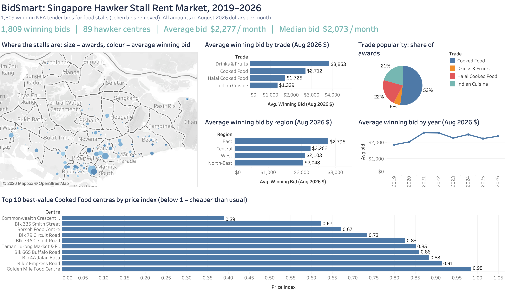
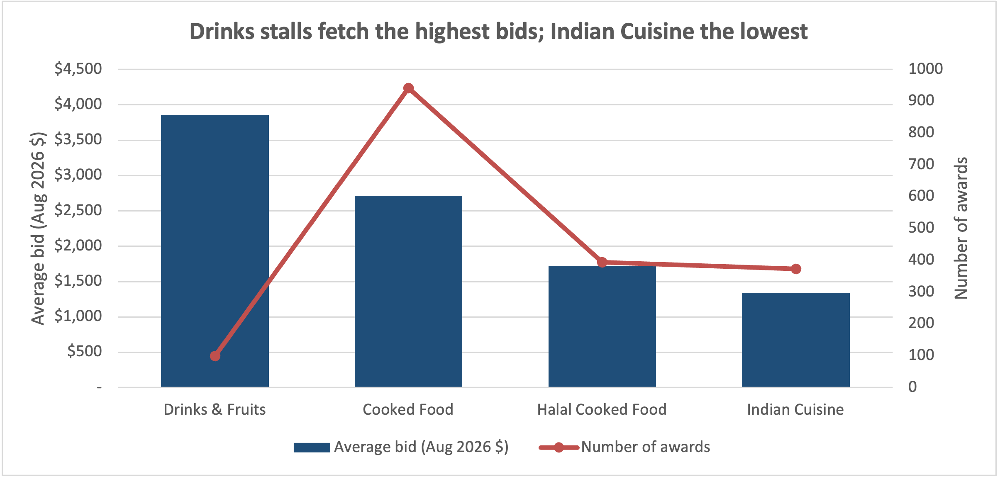
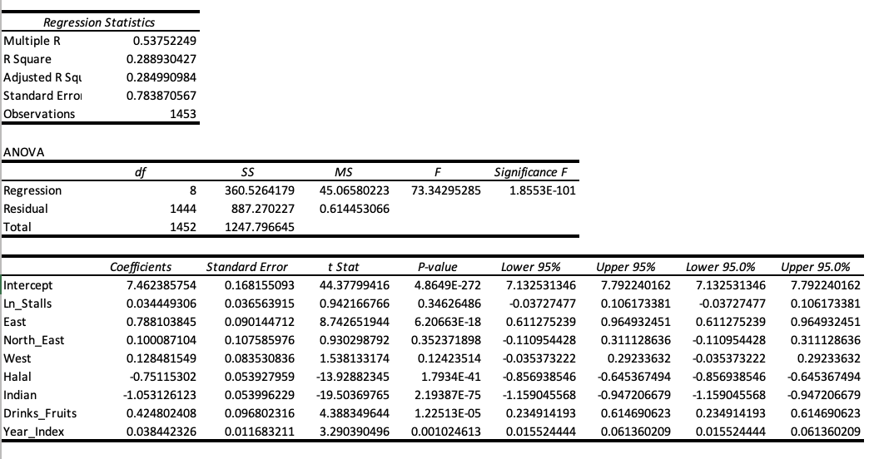
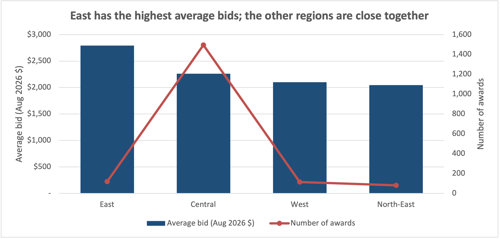
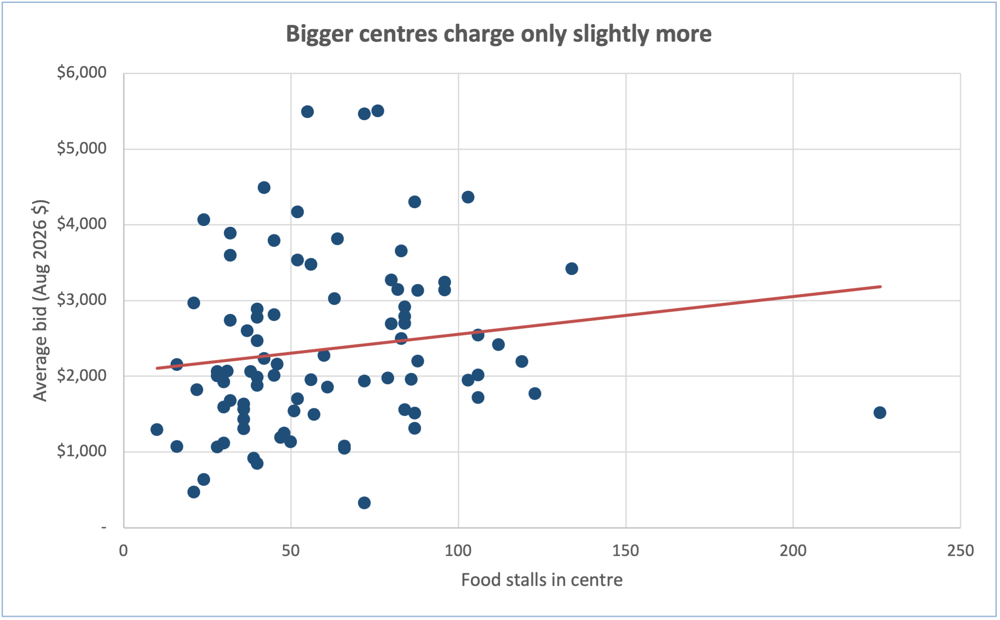
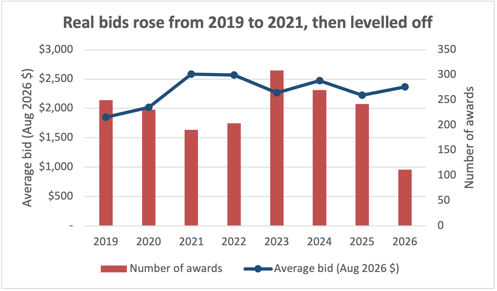
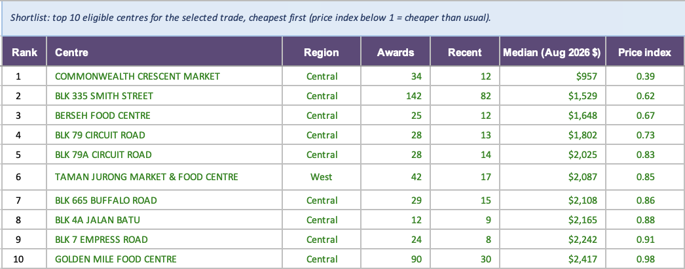
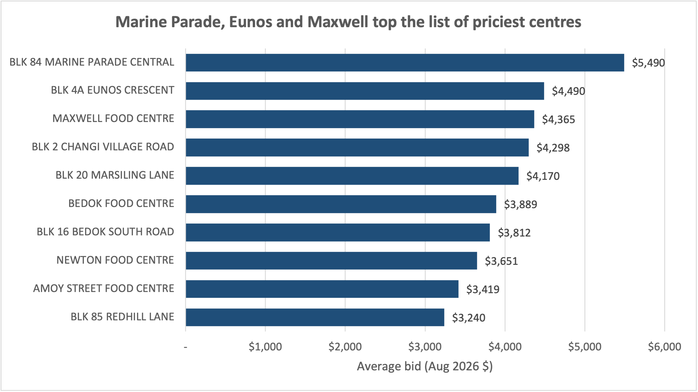

# BidSmart: Hawker Stall Tender Bidding Model

An Excel decision model that helps hawkers decide **how much to bid** for a Singapore NEA hawker stall tender. It uses 1,889 real tender awards from 2019 to 2026.

> Group project for **COR1305 Modeling & Data Analytics**, Singapore Management University (Team G6T4, 5 members).
> **My part:** data cleaning (led, with a teammate) and **Stage 1: market analysis and bid prediction**.

---

## The problem

NEA rents out hawker stalls through sealed-bid tenders: the highest monthly rent bid wins. Bidders face a trade-off:

- **Bid too low** and you lose the stall.
- **Bid too high** and you overpay rent every month for a 3-year tenancy.

Most hawkers guess. BidSmart uses past tender data to show what similar stalls actually went for, predict the usual winning bid for any stall, and estimate how competitive a tender is likely to be.

---

## Data

| Dataset | Source | Size |
|---|---|---|
| Winning tender bids, Jan 2019 – May 2026 | NEA, tender results (94-page PDF) | 4,970 tenders → **1,889 food-stall awards** |
| Top 5 bids per stall (competitor bids) | NEA, provisional tender results | 7 tender rounds (Apr 2023 – Sep 2024), **205 food-stall tenders** |
| Hawker centre size and location | data.gov.sg (centre list, NEA hawker centre map data) | 89 centres used in the model |
| Inflation (CPI, All Items) | SingStat | Monthly, Jan 2019 – Aug 2026 |

All data is publicly available.

---

## What I did

### 1. Data cleaning
- Extracted and structured **4,970 tender records** from NEA's 94-page PDF, in **34 documented cleaning steps** (text-to-number conversion, date fixes, centre-name standardisation, duplicate checks).
- Flagged **token bids** (under $100/month, e.g. $1) and **statistical outliers**.
- Converted every bid to **August 2026 dollars** using the CPI, so bids from different years can be compared fairly.
- Matched each centre to its region, size and map location.

### 2. Descriptive and location analysis
- Pivot tables and charts of winning bids by year, trade, region and centre.
- Tested whether bigger hawker centres charge higher rent (correlation **0.15**: barely any link).

### 3. Bid prediction model (regression)
- **Log-linear regression** in Excel (Analysis ToolPak) on **1,453 bids from 2019–2024**, with **8 predictors**: centre size, region, trade and year.
- Tested on **353 bids from 2025–26** that the model had never seen (a holdout test).
- Re-ran without outliers to check that a few extreme bids weren't driving the results (they weren't).

### 4. Similar-stall benchmarks
- What similar stalls (same trade and region, last 36 months) actually went for: count, average and median.
- Automatically widens to all regions when fewer than 10 similar stalls exist, so the figures stay reliable.

### 5. Competition analysis
- Used NEA's top-5 bid lists to measure how contested stalls are.
- NEA only publishes the 5 highest bids, so the true number of bidders is hidden. I handled this with **low / mid / high scenarios (5 / 9 / 13 bidders)**.

### 6. Centre shortlist
- Ranked centres by a **price index** (centre's median rent ÷ market median for that trade), keeping only centres with enough history and recent tenders.
- Produces a **top-10 best-value shortlist** for any trade.

### 7. Documentation and handoff
- A one-page outputs sheet and a full notes sheet (glossary, decisions, assumptions, limitations), used by teammates building the bid optimiser and dashboard.

---

## Tableau dashboard

An interactive market overview built from the cleaned data: 1,809 winning bids across 89 hawker centres, all in August 2026 dollars.

- **Map:** every hawker centre, sized by number of awards and coloured by average winning bid.
- **Bids by trade, region and year,** plus how popular each trade is.
- **Best-value centres:** eligible centres ranked by price index (below 1 = cheaper than the trade's usual price).
- **Filters** for trade and region.

Download [`tableau/BidSmart_Market_Dashboard.twbx`](tableau/BidSmart_Market_Dashboard.twbx) and open it in Tableau Desktop or the free Tableau Public app.

---

## Key findings

**1. Trade matters most.** Holding region, size and year constant:

| Compared with general Cooked Food | Effect on winning bid |
|---|---|
| Drinks & Fruits | **+53%** |
| Halal Cooked Food | **−53%** |
| Indian Cuisine | **−65%** |

**2. Location matters.** On raw averages, East stalls win at **$2,796 vs $2,262 in Central (+24%)**. Once trade, centre size and year are held constant, the regression puts the East premium much higher (**about 2.2× Central**), because 72% of East's awards are lower-rent Halal and Indian stalls (vs 39% in Central), which pulls East's raw average down. Compare like with like and the East gap widens. North-East and West show no reliable difference from Central.

Centre size barely matters: bigger centres charge only slightly more (correlation **0.15**).

**3. Rents are rising.** Winning bids grow about **4% a year** even after removing inflation (regression estimate). Raw averages rose sharply from 2019 to 2021, then levelled off.

**4. Competition is high.** **50%** of food-stall tenders drew 5 or more bidders (the most NEA publishes).

**5. Best-value centres** (General Cooked Food, cheapest relative to the market):

| Rank | Centre | Price index |
|---|---|---|
| 1 | Commonwealth Crescent Market | 0.39 |
| 2 | Blk 335 Smith Street | 0.62 |
| 3 | Berseh Food Centre | 0.67 |

Premium centres such as **Maxwell (2.42)**, **Amoy Street (1.64)** and **Newton (1.60)** cost far more than average, likely because of higher demand.

**6. The priciest centres** (highest average winning bid, centres with 5+ awards):

---

## Limitations

- **The model is a guide, not an exact price.** It explains about 29% of the variation in bids (adjusted R² 0.285); bids for similar stalls still vary a lot.
- **It predicts slightly high for recent years.** On 2025–26 bids, actual winners paid less relative to the prediction than in earlier years. This is flagged for the next stage to correct.
- **Hidden competition.** Only the top 5 bids are published, so bidder counts above 5 are estimates.
- **No footfall data.** A cheap centre may simply be a quieter one.
- **Most data is from Central** (~83% of bids), so results for other regions are less certain.

---

## Tools

- **Microsoft Excel:** Pivot Tables, Analysis ToolPak (regression), dynamic lookup and array formulas (COUNTIFS, AVERAGEIFS, MEDIAN(IF), INDEX/MATCH), named ranges, data validation
- **Tableau:** interactive market dashboard (map of hawker centres, bids by trade, region and year, best-value centre shortlist)

---

## How to explore the file

Download [`data/G6T4_BidSmart_Model_S1.xlsx`](data/G6T4_BidSmart_Model_S1.xlsx) and open these sheets first:

1. **S1_Notes:** every decision, assumption and limitation, with a glossary
2. **S1_Outputs:** all key results on one page
3. **S1_Comparables:** change the **trade** and **region** dropdowns (cells B2:B3) and watch the benchmarks and shortlist update

---

## Team

Team G6T4, COR1305 Modeling & Data Analytics, Singapore Management University.
Stage 1 and data cleaning by **Aryan Kashikar**. Stages 2–4 (bid optimiser, scenarios and decision dashboard) are in progress by teammates.
